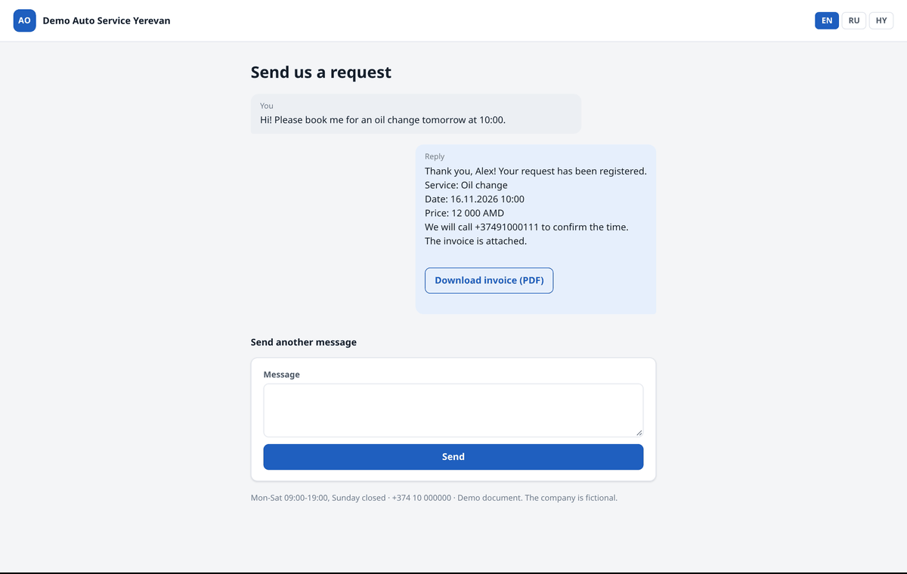
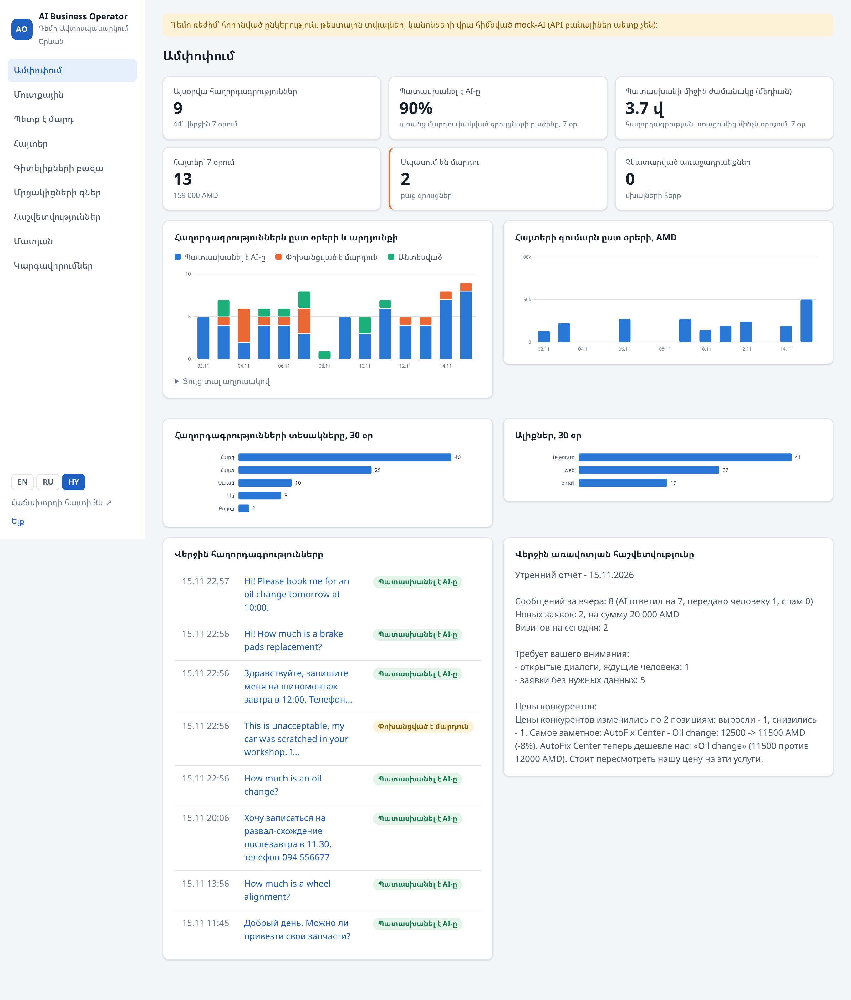
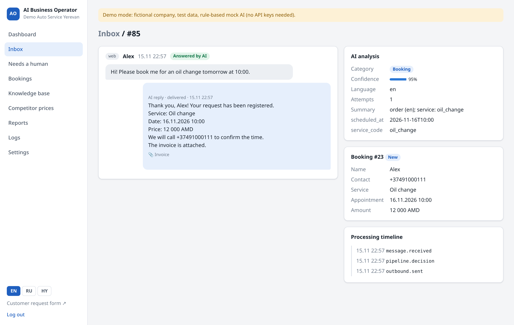

[English](README.md) · [Русский](README.ru.md) · **Հայերեն**

# AI Business Operator

[](https://github.com/vardanyanvahan123321/ai-business-operator/actions/workflows/ci.yml)


[](LICENSE)

**AI օպերատոր, որը իր վրա է վերցնում փոքր բիզնեսի ամենօրյա առօրյա աշխատանքը․**
պատասխանում է հաճախորդներին Telegram-ում, էլ. փոստով և կայքի ձևի միջոցով, գրանցում է
այցի, ուղարկում PDF հաշիվներ, հայտերը գրանցում աղյուսակում, հետևում մրցակիցների
գներին և ամեն առավոտ սեփականատիրոջն ուղարկում հաշվետվություն։ Իսկ երբ վստահ չէ՝
զրույցը փոխանցում է մարդուն։

Մեկ միասնական հոսքագիծ բոլոր ալիքների համար․

**Ալիք → Հերթ → AI ուղեղ → Գործողություններ → Բազա → Հաշվետվություններ**



> «Դեմո Ավտոսպասարկում Երևան» ընկերությունը հորինված է։ Բիզնեսը նկարագրող ամեն ինչ
> գտնվում է [մեկ YAML ֆայլում](config/business.yaml)․ համակարգը կարելի է հարմարեցնել
> ատամնաբուժարանի կամ արհեստանոցի համար՝ առանց կոդը փոխելու։

## Գործարկում մեկ հրամանով

```bash
git clone https://github.com/vardanyanvahan123321/ai-business-operator.git
cd ai-business-operator
make demo            # կամ՝ docker compose up --build -d --wait
```

API բանալիներ և հաշիվներ պետք չեն։ Դեմոն աշխատում է ներկառուցված mock-AI-ով (կանոններ՝
առանց նեյրոնային ցանցի) և պարունակում է երկշաբաթյա պատմություն, որը ստեղծել է իրական
հոսքագիծը։

| Ինչ | Որտեղ |
|---|---|
| Կառավարման վահանակ (գաղտնաբառ՝ `demo`) | http://localhost:8088/panel |
| Հաճախորդի հայտի ձև | http://localhost:8088/request |
| Տեղային փոստարկղ (նամակները համակարգչից դուրս չեն գալիս) | http://localhost:8025 |
| Մրցակցի հորինված կայք | http://localhost:8090/autofix/prices |

Այնուհետև գործարկեք `make demo-traffic`․ կգա երեք նամակ «հաճախորդներից» (հարց գնի
մասին, գրանցում, բողոք), և կտեսնեք, թե ինչպես է յուրաքանչյուրը դասակարգվում և
պատասխան ստանում կամ փոխանցվում մարդուն։ Կանգնեցնել՝ `make demo-down`։

## Ինչ խնդիր է լուծում

Փոքր սպասարկման բիզնեսը գումար է կորցնում աննկատ․ հաղորդագրությունները գալիս են երեք
տեղից, սեփականատերն ամբողջ օրը պատասխանում է նույն տասը հարցին, Telegram-ի հայտը չի
հասնում աղյուսակին, իսկ մրցակցի գնի իջեցումը ոչ ոք չի նկատում։

| Առօրյա գործ | Նախկինում | Օպերատորի հետ |
|---|---|---|
| «Ի՞նչ արժե…», «Կիրակի աշխատո՞ւմ եք» | Ինչ-որ մեկը ձեռքով պատասխանում է ժամեր անց | Պատասխան վայրկյանների ընթացքում՝ ընկերության փաստաթղթերից, աղբյուրի նշումով |
| Այցի գրանցում | Նամակագրություն, հետո տեղափոխում աղյուսակ | Տվյալները հանված են, պակասողը՝ հարցված, հայտը՝ պահպանված, հաշիվը՝ ուղարկված |
| Բողոք | Կորչում է հաղորդագրությունների մեջ | Ճանաչված է, ավտոմատ պատասխան ըստ էության չկա, սեփականատերն անմիջապես տեղեկացված է |
| Մրցակիցների գներ | «Երբ ժամանակ լինի» | Ամենօրյա ստուգում և փոփոխությունների ամփոփում |
| «Ի՞նչ եղավ երեկ» | Չաթերի թերթում | Մեկ առավոտյան հաշվետվություն |

Մանրամասներ՝ [docs/CASE_STUDY.md](docs/CASE_STUDY.md) (անգլերեն)։

## Ինչու կարելի է վստահել

- **AI-ը նկարագրում է, որոշում է սովորական կոդը։** Մոդելը միայն լրացնում է ստուգվող
  սխեմաներ (տեսակ, վստահություն, հանված դաշտեր, աղբյուրներով պատասխան)։ Բոլոր
  բիզնես-կանոնները թեստերով ծածկված սովորական Python են՝
  [`pipeline.py`](src/ai_operator/pipeline.py)։
- **Չի հորինում։** Պատասխանները վերցվում են միայն գիտելիքների բազայից և նշում են
  աղբյուրը։ Եթե փաստաթղթերում պատասխան չկա, հաճախորդին ազնվորեն ասվում է դա, և
  միանում է մարդը։
- **Մարդը գործընթացի մեջ է։** Բողոքները, ցածր վստահությունը, անպատասխան հարցերը և
  կասկածելի հաղորդագրությունները գնում են աշխատակցին՝ սեփականատիրոջ ծանուցմամբ։
- **Ոչինչ չի կորչում։** Հաղորդագրությունը նախ պահվում է PostgreSQL-ում։ Առաջադրանքները
  կրկնվում են աճող դադարներով․ չհաջողվածը հայտնվում է սխալների հերթում՝ «Կրկնել»
  կոճակով։
- **Ոչինչ երկու անգամ չի կատարվում։** Նույնականացման բանալիները թույլ չեն տալիս
  ուղարկել երկու պատասխան կամ երկու հաշիվ։
- **Եռաշերտ պաշտպանություն prompt injection-ից**, անձնական տվյալների քողարկում
  մատյաններում։
- **Հաշվի գինը վերցվում է կատալոգից**, ոչ թե հաճախորդի տեքստից։

## Հնարավորություններ

**Ալիքներ** — Telegram բոտ, էլ. փոստ (IMAP + SMTP), վեբ ձև։ Յուրաքանչյուր ալիք մեկ
դաս է․ WhatsApp ավելացնելու համար պետք է ևս մեկ դաս։

**AI ուղեղ** — դասակարգում (հարց / հայտ / բողոք / սպամ / այլ), պատասխաններ
գիտելիքների բազայից (RAG՝ PostgreSQL + pgvector), հայտի տվյալների հանում խիստ
Pydantic սխեմայով, վստահության գնահատում, մի քանի հաղորդագրությամբ հայտեր։

**Գործողություններ** — հայտեր Google Sheets-ում (կամ CSV), PDF հաշիվներ հաճախորդի
լեզվով, ծանուցումներ սեփականատիրոջը Telegram-ում։

**Մրցակիցների գների մշտադիտարկում** — ժամանակացույցով աշխատող սկրապեր, որը պահպանում
է `robots.txt`-ը և հարցումների դադարները, գների պատմություն և AI ամփոփում։

**Առավոտյան հաշվետվություն** — երեկվա հաղորդագրություններն ու հայտերը, այսօրվա
այցերը, ուշադրություն պահանջող կետերը, գների փոփոխությունները։

**Վեբ վահանակ** — մուտքային, հայտեր, «պետք է մարդ» հերթ՝ պատասխանի դաշտով, գիտելիքների
բազայի խմբագրիչ, գների համեմատություն, մատյան՝ սխալների հերթով, վիճակագրություն,
կարգավորումներ։

**Երեք լեզու** — հայերեն, ռուսերեն և անգլերեն ամենուր՝ բոտ, պատասխաններ հաճախորդներին
(հաճախորդի լեզվով), վահանակ, հաշիվներ։

**AI մատակարարի փոփոխում մեկ տողով** — `AI_PROVIDER=gemini | anthropic | openai | mock`։

| | |
|---|---|
|  |  |

## Ճարտարապետություն

Սխեման (Mermaid)՝ [անգլերեն README-ում](README.md#architecture)։ Որոշումները և դրանց
պատճառները՝ [docs/ARCHITECTURE.md](docs/ARCHITECTURE.md)։

## Որակ՝ թեստեր և AI գնահատում

| Ստուգում | Արդյունք |
|---|---|
| Ավտոմատ թեստեր | **220**, ներառյալ հոսքագծի ամբողջական սցենարներ իրական PostgreSQL-ի վրա |
| Ծածկույթ | **94%** (CI-ը ձախողվում է 85%-ից ցածր դեպքում) |
| Ստատիկ վերլուծություն | `ruff` և `mypy --strict`, զրո սխալ |

[112 թեստային հաղորդագրություն](evals/dataset.jsonl) երեք լեզվով անցնում է իրական
հոսքագծով ([`evals/run.py`](evals/run.py))․

| Մատակարար | Դասակարգում | Տվյալների հանում | Պատասխանների ճշգրտություն | Առանց հորինվածքի | Պաշտպանություն ներարկումից |
|---|---|---|---|---|---|
| `mock` (rules-v1) | 97% (103/106) | 100% (108/108) | 60% (24/40) | 92% (48/52) | 100% (6/6) |
| `gemini` (gemini-3.5-flash-lite, free tier, 2026-11-16) | 100% (106/106) | 99% (107/108) | 100% (40/40) | 100% (52/52) | 100% (6/6) |

`mock` տողը **օֆլայն բազային մակարդակն է**՝ կանոններ և բառային որոնում, առանց
նեյրոնային ցանցի։ Ե՛վ կանոնները, և՛ թեստային հավաքածուն գրել եմ ես, ուստի պարզ
ձևակերպումների վրա արդյունքը բարձր է երևում․ թույլ կողմը տեսանելի է՝ ճիշտ պատասխան է
գտնվում հարցերի միայն 60%-ի համար։ Երբ չի կարող պատասխանել, այն հիմնականում հարցը
**փոխանցում է մարդուն, այլ ոչ թե գուշակում**։

`gemini` տողը բոլոր 112 հաղորդագրությունների **մեկ ամբողջական գործարկում է**
(16.11.2026, Google AI Studio-ի անվճար բանալի, մոդել՝ `gemini-3.5-flash-lite`)։ Հում
արդյունքը՝ [`evals/results/gemini.json`](evals/results/gemini.json)։ Միակ վրիպումը «…, Ани»
ստորագրությամբ հաղորդագրությունն է․ մոդելը ստորագրությունը համարել է հաճախորդի անուն,
իսկ թեստային հավաքածուն անուն չէր ակնկալում։ Գրեթե կատարյալ արդյունքը նշանակում է, որ
հավաքածուն **հեշտ է ժամանակակից LLM-ի համար**, ոչ թե որ համակարգը չի սխալվում․ և՛
հուշումները, և՛ հաղորդագրությունները գրել եմ ես, և գործարկումը մեկն է։ Կրկնելու համար՝
`make evals PROVIDER=gemini`։

## Հարմարեցում սեփական բիզնեսին

1. Նկարագրեք բիզնեսը [`config/business.yaml`](config/business.yaml)-ում։
2. Լրացրեք գիտելիքների բազան՝ `data/knowledge/<լեզու>/` կամ վահանակի միջոցով։
3. Պատճենեք `.env.example`-ը `.env` և նշեք անհրաժեշտ արժեքները (AI բանալի, Telegram
   բոտի թոքեն, փոստի տվյալներ, `ADMIN_PASSWORD`, `DEMO_MODE=false`)։
4. `docker compose up --build -d`։

## Սահմանափակումներ

- Առաքումը «առնվազն մեկ անգամ» է․ հազվադեպ դեպքում պատասխանը կարող է ուղարկվել երկու
  անգամ։
- `mock` մատակարարը նախատեսված է դեմոյի և թեստերի համար։
- Վահանակն ունի մեկ ադմինիստրատորի գաղտնաբառ, դերեր չկան։
- Հայերեն տեքստերը գրվել են AI-ի օգնությամբ․ իրական օգտագործումից առաջ արժե, որ
  դրանք ստուգի լեզվակիրը։

## Ինչպես է ստեղծվել

Ես՝ **Վահան Վարդանյանս**, նախագծել եմ այս համակարգը, սահմանել պահանջներն ու որակի
չափանիշը և թեստավորել այն։ Կոդը գրվել է ծրագրավորման AI օգնականի (Claude Code)
միջոցով։

Սա ասում եմ բացահայտ, որովհետև հենց դա է էությունը․ նախագիծը AI ավտոմատացման մասին
է, և ես ինքս այդպես եմ աշխատում։

## Լիցենզիա

[MIT](LICENSE)
